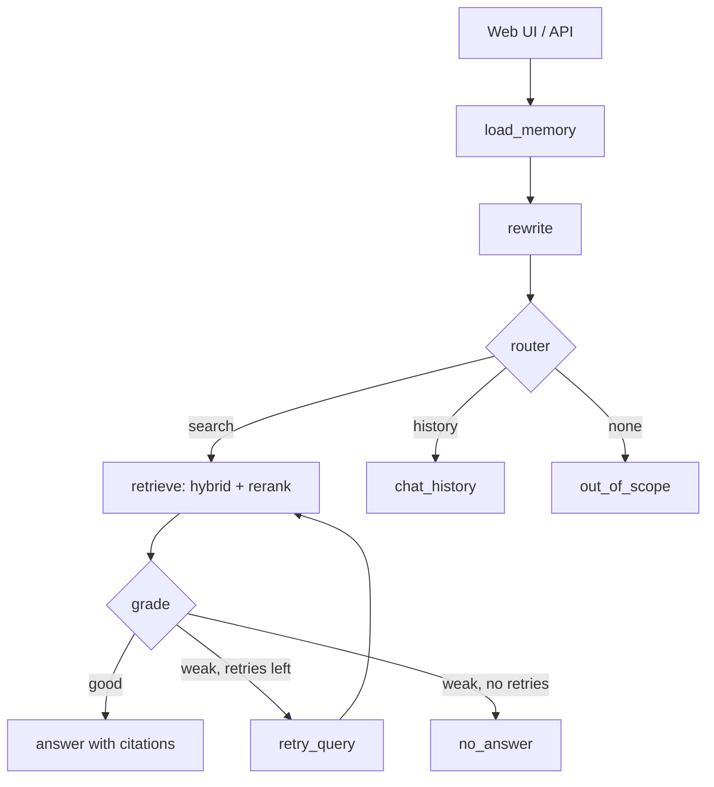

# SehatGuide KP: Healthcare Licensing and Policy Assistant

A multi-user RAG assistant that answers questions about healthcare licensing regulations and Khyber Pakhtunkhwa (KP) health policy. Every answer comes from the loaded documents and cites the file and page. When the documents do not cover a question, it says so instead of guessing.

> Informational use only. This is not legal advice.

## Features

- **Collection routing**: a router sends each question to the licensing collection, the policy collection, both, the conversation history, or a polite refusal.
- **Query rewrite**: follow-ups such as "what documents are needed for that?" become standalone questions, and only when the question depends on earlier messages.
- **Hybrid retrieval**: dense vectors plus BM25 keyword vectors in Qdrant, followed by cross-encoder reranking.
- **Retrieval grading with retry**: weak results trigger a rewritten query and a wider search (at most 2 retries), then an honest "I don't know".
- **Cited answers**: file and page for every source, with the passage readable in the web interface.
- **Session management**: create, list, rename, resume, and delete chats, with automatic titles and per-user isolation.
- **Long-term memory**: user preferences and background carry across chats (LangGraph Store), with view and delete controls.
- **Fallback layers**: backup LLM, safe defaults when both models fail, retrieval errors treated as "no results", and a hard step limit.
- **Web interface**: chat list with search, expandable citations, export to Markdown, memories panel, keyboard shortcuts.

## Architecture



| Data | Stored in |
|---|---|
| Documents (two collections) | Qdrant Cloud |
| Conversation state (per thread) | PostgreSQL, LangGraph checkpointer |
| User memories (per user) | PostgreSQL, LangGraph Store |
| Thread list, titles, owners | PostgreSQL, `threads` table |

## Tech stack

Python 3.11, uv, FastAPI, LangGraph, LangChain, Qdrant Cloud, PostgreSQL, `BAAI/bge-base-en-v1.5` embeddings (768 dimensions, local), Qdrant BM25 sparse vectors (FastEmbed), a cross-encoder reranker, an OpenAI-compatible LLM endpoint (OmniRoute) with a backup model, LangSmith tracing.

## Setup

**Requirements:** Python 3.12, uv, PostgreSQL (local), a Qdrant Cloud cluster, an OpenAI-compatible LLM endpoint.

```bash
git clone <your-repo-url>
cd work-assistant
uv venv --python 3.12
.venv\Scripts\activate          # Mac/Linux: source .venv/bin/activate
uv pip install -r requirements.txt
```

Create the `.env` file from `.env.example` and fill in the values:

| Variable | Meaning |
|---|---|
| `APP_DB_URL` | PostgreSQL connection URL |
| `QDRANT_URL`, `QDRANT_API_KEY` | Qdrant Cloud cluster |
| `LLM_API_KEY`, `BASE_URL` | LLM endpoint |
| `PRIMARY_MODEL`, `FALLBACK_MODEL` | Main and backup chat models |
| `EMBEDDING_MODEL`, `EMBEDDING_DIMENSION` | `BAAI/bge-base-en-v1.5` and `768` |
| `LANGSMITH_TRACING`, `LANGSMITH_API_KEY`, `LANGSMITH_PROJECT` | Optional tracing |
| `MAX_RETRIEVAL_RETRIES` | Optional, default 2 |

Do not change the embedding model after loading data. Doing so requires re-seeding every collection.

## Prepare data and run

Put your PDFs in `data/licensing_regulations/` and `data/health_policy_kpk/`. The folder names become the collection names.

```bash
python -m scripts.setup_checkpointer     # LangGraph tables
python -m scripts.setup_threads_table    # thread list table
python -m scripts.seed_qdrant            # chunk, embed, and load both collections
uvicorn app.main:app --reload
```

Open http://127.0.0.1:8000 for the web interface, or http://127.0.0.1:8000/docs for the API.

## API

All endpoints are under `/api/v1` and need an `X-User-Id` header.

| Method | Path | Purpose |
|---|---|---|
| POST | `/threads` | Create a chat |
| GET | `/threads` | List your chats |
| PATCH | `/threads/{id}` | Rename |
| DELETE | `/threads/{id}` | Delete a chat and its messages |
| GET | `/threads/{id}/messages` | Read the history |
| POST | `/threads/{id}/chat` | Ask a question, returns `answer` and `sources` |
| GET, DELETE | `/memories`, `/memories/{key}` | View and delete memories |

Other users receive a 404 for threads they do not own. Authentication here is a plain header for demonstration. Production use needs real authentication.

## Evaluation

Three scripts measure quality:

- `scripts/run_eval.py` scores routing, retrieval hits, "I don't know" behavior, and citations.
- `scripts/run_ragas.py` is a RAGAS-style LLM-as-judge run (faithfulness, answer relevancy, context precision, context recall). It uses plain-text scoring because the free LLM endpoint rejects the structured output RAGAS requires.
- `scripts/test_failures.py` breaks the LLM or Qdrant on purpose and checks that nothing crashes.

Final judge scores on the answerable questions, after reranking and an adaptive number of chunks (3 for one collection, 5 for two):

| Metric | Score |
|---|---|
| Faithfulness | 0.97 |
| Answer relevancy | 0.98 |
| Context recall | 0.97 |
| Context precision | 0.52 |

Dense-only retrieval found the right source page for 85% of the first 10 test questions. Precision is capped near 0.33 for single-fact questions because a few chunks are always sent to the model. Judge scores come from a free LLM, so use them to compare changes, not as exact truth. The full history of each run is in `docs/eval_log.md`.

## Project structure

```
app/
  api/          endpoints and request models
  config/       settings and collection descriptions
  graph/        state, nodes, routing functions, graph builder
  memory/       long-term memory read and write
  rag/          embeddings, LLM, retriever, reranker
  sessions/     connection pool and thread storage
  static/       web interface (index.html)
  main.py       FastAPI app
scripts/        setup, seeding, tests, evaluation
tests/eval/     evaluation questions
docs/           inventory and evaluation log
```

## Limitations

- English documents only. Urdu text and scanned PDFs are not handled.
- Answers cover only the loaded documents.
- Login is a demo header, not real authentication.
- Memory extraction depends on an LLM and can miss or mis-save facts.
- Source passages shown in the interface are the retrieved chunks, not the full page.

## Future work

Streaming responses, real authentication, more documents, Urdu support, and a supervisor with specialist agents.
